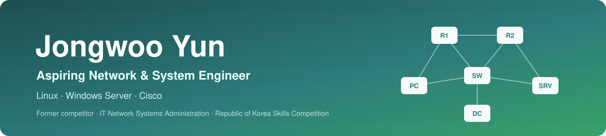

<a href="../README.md">English</a> | <a href="README.ko.md">한국어</a> | <b>日本語</b> | <a href="README.zh-CN.md">简体中文</a> | <a href="README.es.md">Español</a> | <a href="README.fr.md">Français</a>

## 👋 自己紹介

- **Linux · Windows Server · Cisco** を扱う**ネットワーク・システムエンジニア**を目指しています。
- **大韓民国**技能競技大会 **IT ネットワークシステム管理**職種の選手出身です。
- 2026 年の京畿道技能競技大会で金メダルを獲得して**京畿道代表選手**の資格を得て、京畿道代表として第 61 回仁川全国技能競技大会に出場しました。
- 学んだことはすべて **6 か国語**のノートにまとめて GitHub で公開しています。

## 🏆 受賞歴

| 年 | 大会 | 結果 |
| --- | --- | --- |
| 2026 | 京畿道技能競技大会 — IT ネットワークシステム管理職種 | **🥇 金メダル** |
| 2026 | 第 61 回仁川全国技能競技大会 — IT ネットワークシステム管理職種 | **🏅 奨励賞** |

## 🛠️ 技術スタック

**ネットワーク**

  

**Windows Server**

     

**Linux**

   

**仮想化・ツール**

      

## 📚 いま学んでいること

- VMware ESXi
- ネットワーク
- Debian Linux
- クラウドコンピューティング

## 📂 リポジトリ

> この一覧は GitHub Actions が毎日自動で更新します。

<!-- REPOS:START -->
| リポジトリ | 説明 | 言語 | 更新 |
| --- | --- | --- | --- |
| [Network](https://github.com/jongwooish/Network) | Cisco スイッチングのまとめ: VLAN・トランク、RSTP、STP、MSTP、STP チューニング（EVE-NG 実習キャプチャー付き） | — | 2026-11-24 |
| [JJongMarket-IDC-Lab](https://github.com/jongwooish/JJongMarket-IDC-Lab) | 架空のオンラインショップがクラウドから IDC へ移るという設定で、Debian VM 8 台に会社のインフラ全体を構築（ファイアウォール、Web 冗長化、DNS、VPN、バックアップ、監視） | PHP | 2026-11-20 |
| [Server](https://github.com/jongwooish/Server) | Windows Server、Active Directory、Debian Linux インストールガイド、RAID、VMware のまとめ | Shell | 2026-11-20 |
| [claude-squeeze](https://github.com/jongwooish/claude-squeeze) | 長いコマンド出力を Claude のコンテキストに入れない、Claude Code 用のトークン節約ツール（Rust、依存関係ゼロ） | Rust | 2026-11-10 |
<!-- REPOS:END -->

## 📊 GitHub の統計

  
  

